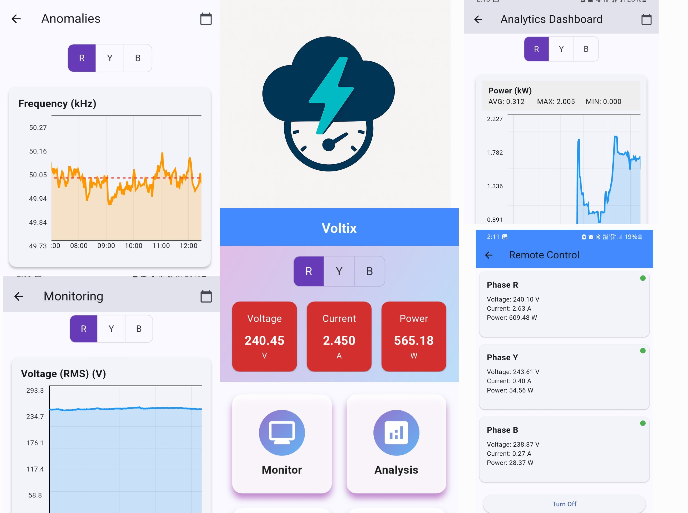

# 📘 Voltix User Manual

Welcome to **Voltix** – your smart 3-phase energy monitoring and control system. This guide will walk you through basic usage and features.

---

## 📦 What’s Included

- ✅ Voltix Energy Meter Device (installed at source)
- 📱 Voltix Mobile Application (Android)
- ☁️ Cloud Server with user-specific dashboards
- 🔌 Relay control for remote switching

---

## 🧑‍💼 For Consumers

### 1. 📲 Using Voltix (the Mobile App)



- **Register** by scanning the QR code, then entering your username and password.
- **Login** using your registered credentials.
- **Dashboard** displays real-time:
  - Voltage & Current per phase
  - Active, Reactive, and Apparent Power
  - Energy Consumption (kWh)
  - Power Factor, THD, and Frequency
- **Monitor** shows daily and hourly usage trends.
- **Remote Control** allows toggling supply via relays.
- **Anomaly Detection** includes plots for:
  - Current and Voltage THD
  - Frequency variations
  - Power Factor anomalies
- **Analysis** provides trends and historical data for **Energy Consumption** and **Power**.

### 2. 🖥️ Using RPi (Local Interface)

- **Home Page**: Displays instantaneous Voltage, Current, and Power values for all three phases.
- **V/I Page**: Shows plots of Voltage RMS and Current RMS.
- **Harmonics Page**: Displays THD values for Voltage and Current.
- **History Page**: Visualizes historical data for Power and Energy.
- **QR Page**: Generates QR code for signing up via Voltix.
- **Control Page**: Allows relay control for each phase.

---

## ⚙️ For Technicians/Admins

### Setting Up

1. Install the Voltix meter at the mainline of a 3-phase supply.
2. Connect RPi and boot up – it auto-starts `app.py` GUI and begins logging.
3. Ensure Wi-Fi or Ethernet connection to allow syncing and control.
4. Use the local interface (touchscreen or monitor) to check live data.

### Data Management

- Local SQLite DB stores all readings temporarily.
- **`sync.py`** uploads new data to the cloud every 10 seconds.
- In case of disconnection, data remains stored until reconnected.

**NOTE**: Further instructions for setting up the server and database are available in the `Server` directory.

---

## 💡 Troubleshooting

| Issue               | Solution                                       |
| ------------------- | ---------------------------------------------- |
| App not syncing     | Check internet on RPi or Restart `sync.py`     |
| Relay not working   | Restart `relay.py` or ensure WebSocket is live |
| Values not updating | Restart `api.py` or verify ADE9000 IC wiring   |

---

## 🔐 Safety Notes

- Never handle wiring while power is on.
- Only qualified technicians should install the hardware.
- Ensure secure mounting of RPi and connections to avoid short circuits.

---

## 🛠 Support

Contact your installer or Voltix support team via the app for help.

---

```

```
