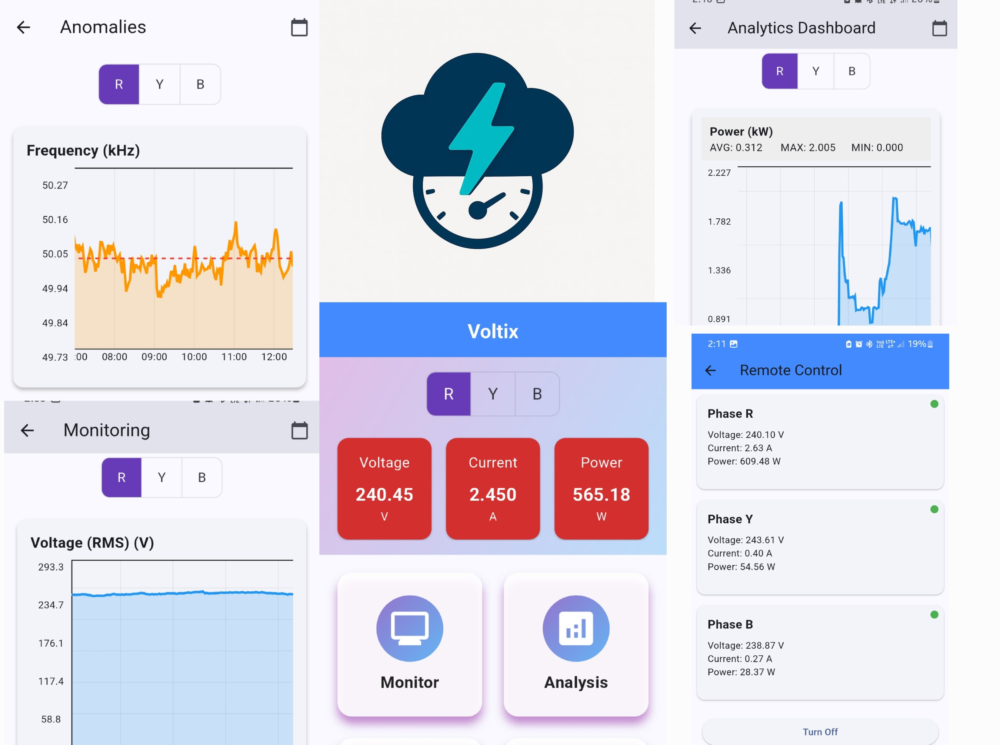

# 📘 Voltix User Manual

Welcome to **Voltix** – your smart 3-phase energy monitoring and control system. This guide will walk you through basic usage and features.

---

## 📦 What’s Included

- ✅ Voltix Energy Meter Device (installed at source), with a touchscreen
- 🌐 Voltix web app (the Android app is being rewritten)
- ☁️ Cloud server with per-user dashboards
- 🔌 Relay control for remote switching, with safety checks on the meter itself

---

## 🧑‍💼 For Consumers

### 1. 🌐 Using the Voltix app

- **Register:** open **Get QR** on the meter's screen and scan it (or type the code shown). Codes last 10 minutes and work once. Add an email address if you want to be able to reset a forgotten password.
- **Dashboard:** live voltage, current, power (active, reactive, apparent), power factor, frequency, THD and energy per phase, updated every second.
- **Monitor:** energy used per hour of a day and per day of a month.
- **Analysis:** power statistics and the energy curve for any day.
- **Power quality:** voltage, frequency, THD and power factor over a day, plus a list of supply interruptions.
- **Control:** switch each phase on or off. The meter confirms every switch with its own measurement and may refuse for safety (see below).
- **Insights:** how evenly your load is spread across the three phases, which circuits are worth moving, and a bill forecast for your tariff.
- **Account:** change your password, set a recovery email, log out of every device.

**Why the meter sometimes refuses a switch**

| Message | Meaning |
| --- | --- |
| *Wait N s (minimum off-time …)* | A phase stays off for at least 3 minutes, to protect AC and fridge compressors. |
| *Not switching phase … on: supply too low / too high / no supply* | The incoming supply is outside the safe range; try again when it recovers. |
| *Relay … did not open: still N A* | The relay contacts may be welded. Isolate the supply manually and call an electrician. |
| *Overcurrent trip* | The phase drew more than 32 A, so the meter switched it off on its own. |

### 2. 🖥️ Using the meter's touchscreen

- **Home:** instantaneous voltage, current, power and power factor for all three phases and the neutral.
- **V - I:** today's voltage and current plots.
- **Power / Energy:** today's power and energy plots.
- **Harmonics:** voltage and current THD and frequency per phase.
- **History:** energy per day for any month.
- **Failure Log:** the last supply interruptions per phase.
- **Get QR:** the sign-up code for the app.
- **Energy Reset:** resets the energy counters (asks for confirmation; history is kept).

---

## ⚙️ For Technicians/Admins

### Setting Up

1. Install the meter at the mains of a 3-phase supply.
2. Provision it on the server: `python manage.py provision-device --device-id <id> --env-out device.env --hal hardware`, and copy `device.env` to the Pi (keep it secret).
3. Run `python3 hw_selftest.py` on the Pi to check the ADE9000 and the voltages.
4. Start the meter processes (`api.py`, `sync.py`, `relay.py`, `failure_log.py`, `app.py`) and connect Wi-Fi or Ethernet.

### Data Management

- The meter keeps every reading in a local database until the server confirms it has stored it; nothing is lost during an internet outage.
- Readings reach the cloud in two ways: the newest one every second (live view) and all of them in batches every 10 seconds.
- The server keeps 1-second data for 30 days, hourly summaries for 400 days and daily summaries forever.

**NOTE**: Server setup is described in `src/Server/README.md`.

---

## 💡 Troubleshooting

| Issue | Solution |
| --- | --- |
| App shows "meter offline" | Check the Pi's internet connection; `relay.py` reconnects on its own. |
| Live values stale | Check `api.py` is running; run `hw_selftest.py` to test the ADE9000 wiring. |
| Data missing in the cloud | It is buffered on the meter and uploads automatically once online. |
| Can't log in ("Too many attempts") | Wait the time shown (up to 15 minutes), or reset the password by email. |

---

## 🔐 Safety Notes

- Never handle wiring while power is on.
- Only qualified technicians should install the hardware.
- Ensure secure mounting of RPi and connections to avoid short circuits.

---

## 🛠 Support

Contact your installer or Voltix support team via the app for help.

---
