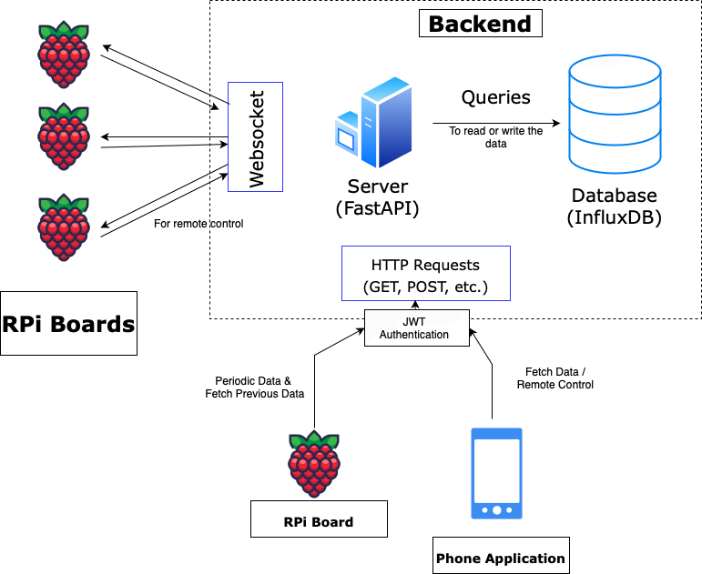

# Server Architecture Overview

This document describes the overall architecture of our server application, the reasons behind our technology choices, and how our approach has evolved over time. Below is a diagram illustrating the current system setup:

## Technology Choices

### 1. FastAPI for the Backend

- **Reasoning**:
  - **Django** was deemed too heavy for our needs, especially since we wanted something lightweight for both HTTP and WebSocket handling.
  - **Flask** is too minimal for our product, and it doesn’t natively handle WebSockets as elegantly.
  - **FastAPI** strikes a balance: it’s performant, easy to integrate with WebSockets, and works well with various databases (including InfluxDB).

### 2. InfluxDB for Time-Series Data

- **Reasoning**:
  - We deal with time-indexed data (power metrics like voltage, current, power factor, THD, etc.).
  - **InfluxDB** is optimized for time-series storage and querying, which fits our use case better than a general NoSQL database like MongoDB.
  - It provides powerful querying, retention policies, and downsampling capabilities out of the box.

### 3. Flutter for the Frontend

- **Reasoning**:
  - We needed a cross-platform solution for mobile and possibly desktop/web in the future.
  - The team was already familiar with **Flutter**, which sped up development.

### 4. SQLite for Local Caching on the RPi

- **Reasoning**:
  - In scenarios where the RPi cannot send data to the server (e.g., network downtime), we locally store the data in **SQLite**.
  - SQLite is file-based, lightweight, and well-suited for embedded environments.
  - Once the connection is restored, the RPi pushes any cached data to the server, and older entries are cleaned up if they’re beyond 3 days.

## System Evolution

1. **Initial Plan (Waveform Storage)**

   - We initially considered storing raw waveforms from the ADE9000 to analyze full harmonic spectra.
   - This proved too large and less necessary for our immediate goals.

2. **Current Data Collection (RMS & Power Metrics)**

   - We now store the following RMS and power-related fields each second, for each phase:
     - `power_watt`
     - `power_var`
     - `power_va`
     - `voltage_rms`
     - `current_rms`
     - `power_factor`
     - `voltage_thd`
     - `current_thd`
     - `energy_kwh`
   - These values provide enough insight for real-time monitoring and analytics without the overhead of storing raw waveforms.

3. **Local Data Storage on RPi**
   - In case of network issues, the RPi caches data in SQLite.
   - **Approximate Storage Calculation**:
     - Sampling every second for 6 hours = `60 sec * 60 min * 6 hr = 21,600` samples.
     - For 3 phases, that’s `21,600 * 3 = 64,800` phase-specific samples.
     - With 9 fields, total data points = `64,800 * 9 ≈ 583,200`.
     - Assuming 8 bytes per float, that’s roughly `4.66 MB` over 6 hours (plus some overhead for SQLite).
   - After the RPi successfully sends cached data to the server (and if it’s older than 3 days), it is deleted to free space.

## Server Setup Details (current)

The endpoint reference is in [README.md](./README.md#api); the interactive version is at `/docs`.

1. **Authentication**
   - Users: JWT from `/auth/login` or `/auth/sign-up`, carrying a token version so a password change or "log out everywhere" ends every session. Passwords are PBKDF2-hashed; login and sign-up are rate-limited with per-account lockout; password reset uses single-use, hashed, 15-minute email links.
   - Meters: each has its own key (`X-Device-Id` / `X-Device-Key`), issued by `manage.py provision-device`. Only its hash is stored.
   - Sign-up proves physical access: the meter shows a short-lived, one-time QR code encrypted with its own claim key.

2. **Two data paths from the meter**
   - Durable (`POST /api/write-data`, every 10 s): batched, acknowledged, idempotent; the meter buffers while offline.
   - Live (`POST /api/live`, every second): newest sample only, best effort, pushed to browsers over `WS /ws/live`.

3. **Storage** (`storage/`): one interface, two backends. SQLite locally (raw 1 Hz data, hourly and daily rollups, retention); InfluxDB in the cloud (native retention and downsampling tasks, `deploy/influx_downsampling.flux`). Users, meters, the relay shadow and audit log live in a relational DB (`utils/database.py`).

4. **Remote control** (`WS /ws`): the meter keeps an authenticated WebSocket open. `POST /remote-control` sends a command and waits for the meter's acknowledgement, which only comes after the meter has applied its safety checks (interlocks, closed-loop verification). The server keeps desired vs reported state and audits automatic actions such as overcurrent trips.

5. **Analytics** (`analytics/`): computed on read from the rollups: consumption per hour/day, power statistics, phase-balance advice and bill forecasts.

## Conclusion

Our architecture is designed for:

- **Efficiency** in handling real-time sensor data.
- **Scalability** via InfluxDB’s time-series capabilities.
- **Flexibility** for clients: a web app today, the Flutter app once rewritten.
- **Reliability** with SQLite as a local fallback store on the RPi.

This setup ensures robust data collection, easy remote control, and a smooth user experience for monitoring and managing power parameters in real-time.
