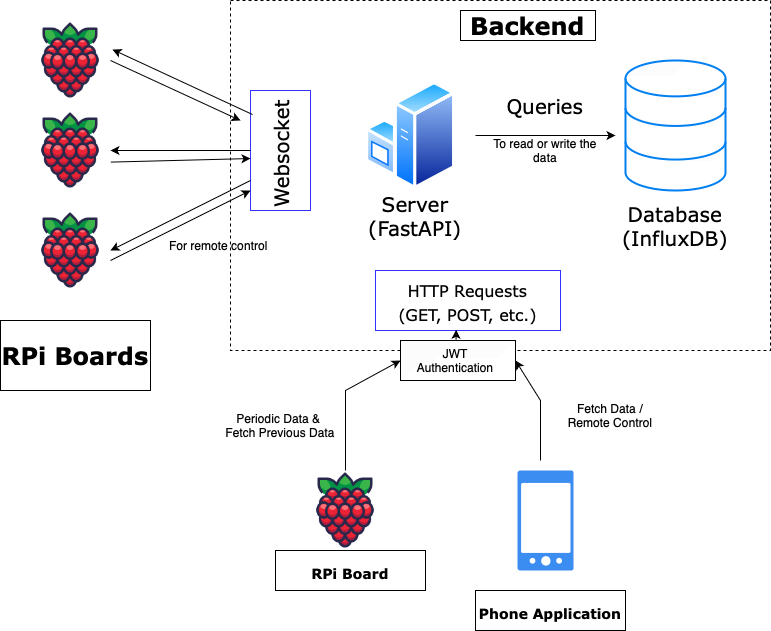

# ⚡ Voltix server

FastAPI backend. It authenticates users and meters, ingests readings, serves analytics, relays commands to meters over WebSockets, and serves the web app at `/app`.



The architecture rationale is in [DOC.md](./DOC.md). Open bugs and planned features are in [docs/BUGFIXES.md](../../docs/BUGFIXES.md).

---

## Structure

```
api/          auth.py (accounts, claiming), routes.py (ingest + data), websockets.py (device socket, relays),
              dependencies.py (auth), services.py (device connection hub)
analytics/    consumption / power analytics computed on read
storage/      TimeSeriesStore interface; sqlite_store.py (local), influx_store.py (cloud)
utils/        database.py (users, devices, claim nonces, relay audit), security.py, models.py
config.py     validated settings
manage.py     init-env, provision-device, list-devices
main.py       app wiring, CORS, static web app
```

---

## Setup

```bash
pip install -r requirements.txt
python manage.py init-env                       # writes .env with a random SECRET_KEY
python manage.py provision-device --device-id meter-001 --env-out ../RPi/device.env
uvicorn main:app --reload
```

`python scripts/run_local.py` from the repo root does all of this, plus the virtual board and the firmware.

### Settings (`.env` or environment)

| Variable | Default | Meaning |
|---|---|---|
| `SECRET_KEY` | required | JWT signing key, at least 32 characters |
| `STORAGE_BACKEND` | `sqlite` | `influx` for the cloud |
| `INFLUXDB_URL`, `INFLUXDB_TOKEN`, `INFLUXDB_ORG`, `INFLUXDB_BUCKET` | – | Required with `influx` |
| `DATA_DIR` | `src/Server/data` | SQLite files (`timeseries.db`, `voltix.db`) |
| `ACCESS_TOKEN_EXPIRE_MINUTES` | `60` | Login session length |
| `CLAIM_TTL_SECONDS` | `600` | Validity of a meter's sign-up QR code |
| `CORS_ORIGINS` | localhost:8000 | JSON list of allowed browser origins |
| `TIMEZONE` | `Asia/Kolkata` | Defines "a day" for analytics |

---

## API

User routes need `Authorization: Bearer <token>` from `/auth/login` or `/auth/sign-up`, and only return meters the user owns. Device routes need `X-Device-Id` and `X-Device-Key`.

| Method and path | Caller | Purpose |
|---|---|---|
| `POST /auth/sign-up` | public | `{username, password, claim_code}`: claim a meter with its one-time QR code and create the account |
| `POST /auth/login` | public | `{username, password}` → access token |
| `GET /auth/me` | user | Account and meters |
| `POST /auth/claim-device`, `POST /auth/release-device/{id}` | user | Add or give up a meter |
| `POST /api/write-data` | device | Batch of readings (UTC ISO timestamps). Invalid rows are reported in `rejected`, not stored |
| `GET /api/last-energy-data` | device | Latest cumulative energy per phase (resume after restart) |
| `GET /api/devices` | user | Meters with online status and relay state |
| `GET /api/latest-values` | user | Newest reading per phase, with its age |
| `GET /api/series?fields=…&date_str=…&every=…` | user | Averaged time series for a day |
| `GET /api/query-data`, `GET /api/thd-values` | user | Preset series (power/V/I/energy; THD/PF/frequency) |
| `GET /analytics/power`, `/analytics/energy`, `/analytics/energy-daily` | user | Power stats, consumption by hour, consumption by day |
| `POST /remote-control` | user | `{phase: R/Y/B/ALL, command: on/off}`. Waits for the meter's confirmation |
| `GET /remote-control/status`, `/remote-control/history` | user | Relay state, audit log |
| `WS /ws` | device | Relay commands and acknowledgements |
| `GET /api/health` | public | Storage reachability |

Interactive reference: http://127.0.0.1:8000/docs

---

## Moving to the cloud

1. Run InfluxDB (or InfluxDB Cloud). Set `STORAGE_BACKEND=influx` and the `INFLUXDB_*` variables. Try it locally first with `deploy/docker-compose.yml`.
2. Move `utils/database.py` (users, devices) to a managed Postgres. The SQL is portable.
3. Relay connections are held in-process (`api/services.py`). To run more than one worker, add a shared broker (Redis pub/sub or MQTT).
4. Serve `src/WebApp` from a CDN and set `CORS_ORIGINS` to its origin.

---

## 📄 License

Licensed under the [MIT License](./LICENSE).
